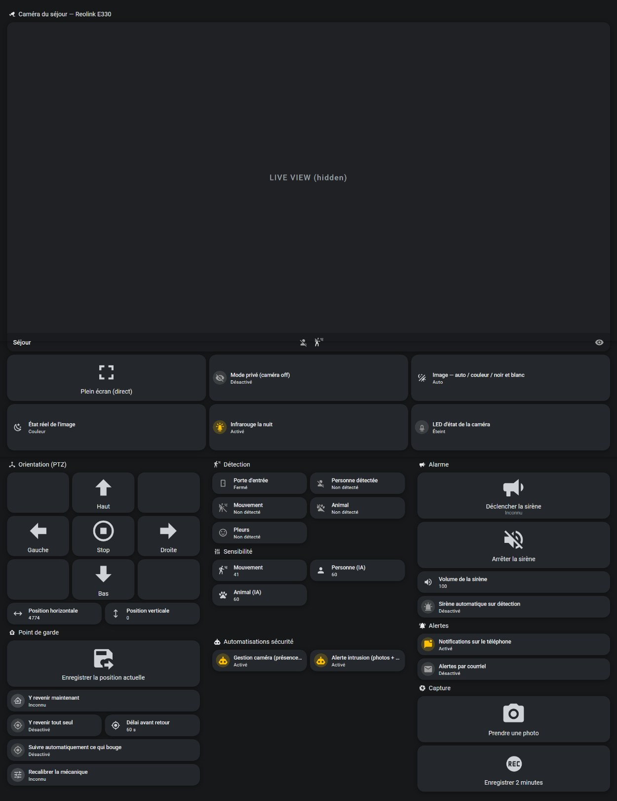

# Reolink camera dashboard for Home Assistant

A Home Assistant dashboard that replaces the Reolink app for a PTZ camera: live view, push-to-talk, PTZ, guard position, detection settings, siren, snapshots and clips. Local only, no Reolink cloud.

## Features

| Block | Controls |
|---|---|
| Live view | preview, fullscreen WebRTC view with a **push-to-talk** button |
| Image | privacy mode, day/night mode, actual day/night state, IR lights, status LED |
| PTZ | D-pad with Stop in the centre (250 ms pulses), pan/tilt position |
| Guard position | save current position, go to, auto-return and delay, auto-tracking, PTZ calibration |
| Detection | person, motion, animal, baby crying, door sensor; motion / AI person / AI animal sensitivity |
| Siren | trigger (with confirmation), stop, volume, siren on event |
| Alerts | camera push notifications and email on event |
| Capture | full-resolution snapshot, 2-minute clip (privacy mode is lifted and restored automatically) |

## Requirements

- Home Assistant 2026.10 (tested), core [Reolink integration](https://www.home-assistant.io/integrations/reolink/)
- [go2rtc](https://github.com/AlexxIT/go2rtc) (standalone) and [WebRTC Camera](https://github.com/AlexxIT/WebRTC) 3.6.1 (serves `video-rtc.js`)
- HTTPS access to Home Assistant: browsers only expose the microphone in a secure context
- Tested with a Reolink E330 (indoor PTZ, Wi-Fi)

## Installation

1. **go2rtc**: one stream, two sources on the camera's sub stream, the second one carrying the audio backchannel. See [`go2rtc.yaml`](go2rtc.yaml).
2. **Reolink integration**: name the device `Living room` (or replace the `living_room_` prefix in the files), and enable the disabled-by-default entities *Clear* and *Snapshots clear* (used for captures).
3. **Card**: copy [`ptt-camera-card.js`](ptt-camera-card.js) to `/config/www/` and add `/local/ptt-camera-card.js` as a dashboard resource (JavaScript module).
4. **Scripts**: add [`scripts.yaml`](scripts.yaml) to your scripts.
5. **Dashboard**: add the two views of [`dashboard.yaml`](dashboard.yaml) under `views:` of a YAML-mode dashboard (`/lovelace/` = your dashboard path).
6. **Media folder**: add `/media/reolink` to `allowlist_external_dirs`.

## Stream setup

A Reolink camera only accepts a few simultaneous RTSP sessions ([integration docs](https://www.home-assistant.io/integrations/reolink/)). When Home Assistant and a relay both opened streams, both sides timed out at the same time, in a loop. Symptom to recognise: `Error demuxing stream` in Home Assistant and `i/o timeout` in go2rtc **simultaneously**.

- **Single RTSP client**: go2rtc holds the only session; Home Assistant, browsers and the microphone go through it.
- **Sub stream for live view**, `h264Preview_01_sub` (explicit H.264). Measured through go2rtc (10 s sample, Oct 2026):

  | Codec | Resolution | Frame rate | Bit rate |
  |---|---|---|---|
  | H.264 High | 896 × 512 | 15 fps | ~300 kbit/s |

- **Main stream for captures only** (measured on a test clip: H.264 2560 × 1440 + AAC): snapshot from the HTTP snapshot endpoint, 2-minute clip from the *Clear* stream.
- **Wake-up delay**: leaving privacy mode, the camera reopens its API then its streams (6 s measured for the API, up to ~30 s for streams). Recording too early can hang `camera.record`, so the capture scripts wait for the entity before capturing.

## PTZ pulses

The integration's PTZ buttons start a **continuous** move until Stop or the end stop. Each arrow calls a script: move, 250 ms, Stop, which matches a short tap in the official app.

## Push-to-talk card

The Reolink integration has no two-way audio. The camera supports it: an RTSP `DESCRIBE` with `Require: www.onvif.org/ver20/backchannel` exposes an extra `sendonly` audio track (PCMU). go2rtc carries it (`#backchannel=1`).

WebRTC Camera 3.6.1 opens the microphone as soon as the card is displayed and keeps it open, with no button. [`ptt-camera-card.js`](ptt-camera-card.js) (~200 lines) extends go2rtc's `VideoRTC`:

- negotiates the microphone once, **muted**, and unmutes it only while the button is held;
- mutes on every exit path: release, pointer leaving the button, tab hidden, page closed;
- forces WebRTC (the microphone does not exist in the MSE fallback);
- reports the failure on screen (insecure context, permission denied, no input device) instead of failing silently.

## Local only

- The camera is controlled through its local HTTP API (the integration's). P2P is disabled.
- Time from the local NTP server; Reolink domains blocked at the DNS (AdGuard Home).
- Recordings stay on the server.

## Notes

- **Privacy mode shuts down the camera's API and streams**: about 30 entities become `unavailable` and the logs fill with demux/timeout errors. Not a failure; check the switch first.
- **go2rtc's API echoes its source URLs, camera password included**, to any client. Set `api.username`/`password` before exposing port 1984, and test from another machine (local requests bypass auth by default).
- **go2rtc warnings contain the full source URL**, and Home Assistant copies them into its log: add `logger: filters:` for the go2rtc and `stream` loggers.
- **Scripting camera settings**: the API is off in privacy mode, so turn it off, act, turn it back on, with a `trap` that restores it on error.

## Experimental: presence-based arming

[`presence/`](presence/) contains five automations and three template sensors that enable privacy mode when someone is home and disable it when everyone has left, with guards: no arming while presence is unknown, a door-opening required as proof of departure, a 45 s grace period, a two-stage intrusion alert (text first, then 3 photos and a 120 s clip) and a watchdog for a stuck alert. State diagram: [`presence/arming.svg`](presence/arming.svg).

**Known issue**: phone-based presence (router + GPS) is not reliable enough; false "nobody home" alerts still occur.

## Roadmap

[Frigate](https://github.com/blakeblackshear/frigate) for object and face detection (faces since 0.16). Its docs recommend [restreaming through a single go2rtc](https://docs.frigate.video/configuration/restream/), which is already the architecture here, with `#backchannel=0` on Frigate's input.

## Files

| File | Content |
|---|---|
| [`dashboard.yaml`](dashboard.yaml) | Security view and fullscreen view |
| [`scripts.yaml`](scripts.yaml) | 4 PTZ pulses, snapshot, 2-minute clip |
| [`ptt-camera-card.js`](ptt-camera-card.js) | push-to-talk card |
| [`go2rtc.yaml`](go2rtc.yaml) | go2rtc stream with backchannel |
| [`presence/`](presence/) | experimental arming automations, template sensors, state diagram |

## Credits

- [Reolink integration](https://www.home-assistant.io/integrations/reolink/) (Home Assistant core)
- [go2rtc](https://github.com/AlexxIT/go2rtc) and [WebRTC Camera](https://github.com/AlexxIT/WebRTC) by AlexxIT (MIT): `ptt-camera-card.js` extends `VideoRTC`, and its `createOffer` is adapted from it
- [TP-Link Router](https://github.com/AlexandrErohin/home-assistant-tplink-router) by AlexandrErohin (router-based presence)

Built with Claude Code: I define the requirements, make the design decisions and validate on the hardware; the agent writes and runs the code.

## License

MIT, see [`LICENSE`](LICENSE). `createOffer` in `ptt-camera-card.js` is adapted from go2rtc (MIT, © AlexxIT).
