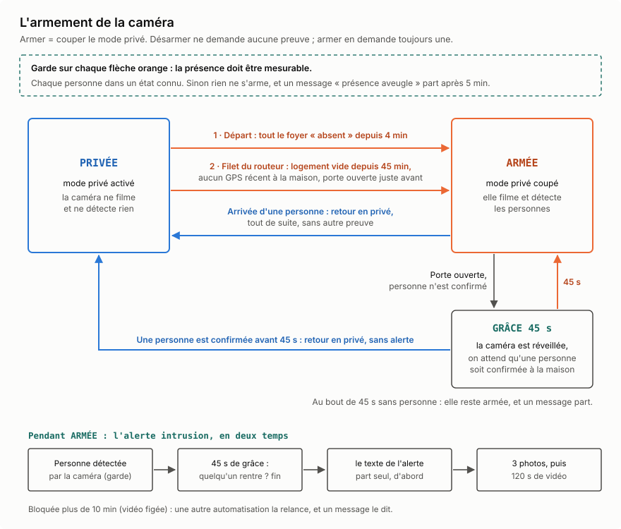

# Une caméra Reolink dans Home Assistant, armée par la présence, sans nuage

**En bref.** Une caméra d'intérieur ne doit filmer que lorsque le logement est vide. Ici, Home Assistant la met en mode privé (elle ne filme plus et ne détecte plus rien) dès qu'une personne du foyer est à la maison, et la réarme quand tout le monde est parti. Le difficile n'est pas d'allumer la caméra, c'est d'être sûr que le logement est vide : un téléphone qui décroche du Wi-Fi, un GPS qui ne donne plus de nouvelles, une mise à jour qui casse la détection ont chacun fait croire à un départ. La règle tirée de ces erreurs tient en une phrase : **dans le doute, on n'arme pas, et le système le dit.** Tout se passe sur le serveur de la maison ; seules les alertes sortent, par Telegram.

## Le matériel

| | |
|---|---|
| Caméra | **Reolink E330** : intérieure, orientable à distance, en Wi-Fi. Elle détecte elle-même les personnes, et son **mode privé** coupe ses flux et sa détection |
| Porte | un capteur d'ouverture sur la porte d'entrée |
| Téléphones | l'application Home Assistant sur chaque téléphone du foyer, pour la position GPS |
| Routeur | interrogé par Home Assistant, il dit quels téléphones sont connectés au Wi-Fi (intégration communautaire [TP-Link Router](https://github.com/AlexandrErohin/home-assistant-tplink-router)) |
| Serveur | Home Assistant 2026.10 en conteneur, avec l'[intégration Reolink](https://www.home-assistant.io/integrations/reolink/) officielle ; alertes par Telegram |

## Qui est à la maison ? Trois témoins, aucun parfait

| Témoin | Ce qu'il voit bien | Où il se trompe |
|---|---|---|
| Le routeur | un téléphone qui se reconnecte : l'arrivée est vue tout de suite | la nuit, un téléphone en veille décroche du Wi-Fi pendant une à quatre heures ; une coupure de 15 minutes a été mesurée, occupants présents |
| Le GPS de l'application | un départ, une fois le téléphone loin | un téléphone immobile n'envoie rien : sa dernière position peut dater de plusieurs heures |
| La porte | une ouverture, avec certitude | elle ne dit ni qui, ni dans quel sens |

Quand une personne a plusieurs traqueurs, Home Assistant croit le routeur lorsqu'il dit « à la maison », et le GPS sinon ([documentation de l'entité `person`](https://www.home-assistant.io/integrations/person/)). Une arrivée est donc vue tout de suite ; un départ dépend du GPS.

Ce que ça donne, mesuré : le routeur a vu les deux téléphones quitter le logement, et la personne est restée « à la maison » **3 h 10**, parce que son GPS n'avait rien envoyé depuis. Caméra non armée, lampes allumées. Au retour, routeur, personne et caméra ont basculé dans la même seconde. **Un GPS périmé a battu un routeur juste.**

Retirer le GPS de la personne aurait réglé ce cas et créé l'inverse : une coupure Wi-Fi d'un quart d'heure, chez soi, aurait armé la caméra. Les deux sont gardés, et un filet rattrape les départs manqués (plus bas).

## La logique d'armement



**Armer**, c'est couper le mode privé ; **désarmer**, c'est l'activer. Toute la logique repose sur une asymétrie :

- **Désarmer ne demande aucune preuve.** Une personne arrive, ou la porte s'ouvre alors que quelqu'un est déjà là : la caméra repasse en privé, tout de suite.
- **Armer en demande toujours une**, par deux chemins :
  1. **le départ** : toutes les personnes « absentes » depuis 4 minutes, pour ne pas armer sur une absence de quelques instants ;
  2. **le filet du routeur**, pour les départs que l'entité `person` n'a pas vus (détail plus bas).
- **La porte qui s'ouvre alors que personne n'est confirmé** réveille la caméra et ouvre une **grâce de 45 secondes**. En rentrant, la porte s'ouvre 5 à 10 secondes avant que le téléphone ne retrouve le Wi-Fi (mesuré sur deux retours réels). Si une personne est confirmée pendant la grâce, la caméra repasse en privé sans rien dire ; sinon, elle reste armée et un message part.

Le choix : 45 secondes, et rien ne part pendant la grâce, ni photo ni vidéo. Ce même délai retarde l'alerte d'une vraie intrusion : c'est un compromis assumé.

Détail qui compte : dans la branche « porte », la remise en privé est écrite dans la branche elle-même. L'automatisation tourne en mode `single`, et l'arrivée qui survient pendant les 45 secondes d'attente est ignorée ; sans cette ligne, la caméra resterait armée sur la personne qui vient de rentrer.

## Les garde-fous

### Savoir si l'on sait : la présence mesurable

Une mise à jour automatique de l'intégration du routeur a échoué au démarrage de Home Assistant. Ses traqueurs ont disparu, et une personne est passée à l'état `unknown`. Les automatisations demandaient « quelqu'un est-il à la maison ? » : `unknown` n'étant pas `home`, la réponse était « non ». L'autre personne venait réellement de sortir. La caméra s'est armée, et l'alerte intrusion s'est déclenchée sur l'occupant, chez lui.

Le correctif est un capteur, `binary_sensor.presence_mesurable`, qui répond à une autre question : **Home Assistant est-il seulement capable de savoir qui est là ?** Le critère n'est pas évident. Pour répondre « personne n'est là » (la seule réponse qui arme), il faut être sûr de **chaque** personne : une seule `unknown` invalide la réponse. Répondre « quelqu'un est là » ne demanderait qu'un seul `home`. C'est cette asymétrie qui impose le `and`.

Une deuxième condition est venue plus tard. Au démarrage de Home Assistant, un traqueur du routeur peut publier un état contradictoire : « absent », mais situé dans la zone maison (une fois sur 16 démarrages). L'entité `person` le fait passer avant le GPS, et une personne est restée « absente » 23 minutes chez elle. Tant que cette contradiction dure, le capteur considère que l'on ne sait pas.

Chaque branche qui arme exige ce capteur. Il a été éprouvé sur la vraie panne : l'intégration du routeur a été réellement désactivée, avec sa réactivation garantie quoi qu'il arrive (dans un bloc `finally`). Même état de départ que le jour de l'incident : le capteur est passé à `off` en moins de 15 secondes, et la caméra est restée en privé.

### Un voyant plutôt qu'un armement à tort

Quand la présence n'est plus mesurable pendant 5 minutes, un message le dit, avec l'état de chaque traqueur ; un autre annonce le retour à la normale. Le prix est assumé : pendant cette fenêtre, une vraie intrusion ne serait pas filmée. Elle n'existe que lorsqu'une intégration est cassée ou que Home Assistant redémarre, et elle ne passe plus inaperçue. Depuis une version récente, l'intégration du routeur échoue parfois au démarrage : une automatisation la recharge 3 minutes après chaque démarrage, puis toutes les 15 minutes tant que ses capteurs restent indisponibles.

### Le routeur ne prouve pas un départ, la porte si

Le filet est né des 3 h 10 : si le routeur ne voit plus aucun téléphone depuis 45 minutes, et qu'aucun GPS récent (moins de 45 minutes) ne dit « à la maison », la caméra s'arme et les lampes s'éteignent. 45 minutes, c'est trois fois la plus longue coupure du routeur mesurée occupants présents.

Sa première version a armé la caméra **quatre nuits, logement occupé** : la nuit, les téléphones en veille décrochent du Wi-Fi pendant des heures, et un GPS immobile n'envoie rien. La règle qui en est sortie : **la nuit, le routeur n'est pas une preuve d'absence. Toute automatisation qui arme sur la foi du routeur exige une preuve de départ.**

Cette preuve, c'est la porte : on ne quitte pas le logement sans l'ouvrir. Le filet exige maintenant une ouverture entre 60 minutes avant et 2 minutes après le moment où le routeur a perdu les téléphones. Rejoué sur l'historique : les quatre nuits fausses sont écartées, les trois vrais départs de la même période restent armés.

- Le filet est **strictement additif** : il peut armer plus tôt, il ne désarme jamais rien.
- Il n'éteint les lampes que s'il arme vraiment, et ne parle que s'il a rattrapé quelque chose : un voyant qui parle pour rien apprend à l'ignorer.
- La date de dernière ouverture est un capteur à déclencheur, qui garde sa valeur au redémarrage. Le `last_changed` de la porte, lui, est remis à l'heure du démarrage et ferait croire à une ouverture.
- Essayé, puis retiré : demander sa position au téléphone (`request_location_update`) avant d'armer. Rien n'est revenu en 90 secondes : un veto qui ne répond pas ne protège de rien.

## L'alerte en deux temps

Quand la caméra détecte une personne, que la présence est mesurable et que personne n'est confirmé à la maison :

1. **45 secondes de grâce**, comme pour la porte : la personne qui rentre n'est pas filmée ;
2. **le texte de l'alerte part seul** ;
3. puis **3 photos**, à 15 secondes d'intervalle, et **120 secondes de vidéo** sur le flux principal, enregistrées sur un disque du serveur.

Le texte part d'abord parce qu'il voyageait dans la légende de la première photo. Le jour où cette photo n'a pas été écrite à temps, l'alerte est arrivée sans un mot.

L'enregistrement bloque l'automatisation jusqu'à sa fin. Elle tourne en mode `single` : une intrusion, un enregistrement complet ; en mode `restart`, chaque nouvelle détection relancerait la grâce et couperait la vidéo. Le revers : si l'enregistrement se fige, l'automatisation reste « en cours » et plus aucune intrusion n'est signalée, sans aucun voyant. D'où une surveillance. Une exécution normale dure environ 3 minutes ; au-delà de 10 minutes, ou si l'automatisation devient indisponible, elle est arrêtée (ce qui annule l'exécution figée), remise en marche, et un message le dit. Essai manuel réel : relance faite, message parti.

## Le micro dans le tableau de bord

L'intégration Reolink de Home Assistant n'offre pas d'audio bidirectionnel (« *2-way audio or Text-to-speech is not available* », dit [sa documentation](https://www.home-assistant.io/integrations/reolink/)). La caméra, elle, sait le faire.

**Mesurer le prérequis avant d'installer quoi que ce soit.** Une requête RTSP `DESCRIBE` envoyée avec l'en-tête ONVIF `Require: www.onvif.org/ver20/backchannel` fait apparaître, sur le flux principal comme sur le sous-flux, une piste audio de plus, en émission (PCMU) : la voie retour existe. Sans elle, aucune carte n'aurait jamais pu parler dans la caméra.

```
caméra ── sous-flux RTSP + voie retour ──▶ go2rtc ── WebRTC ──▶ navigateur
   │                                                        ▲
   └── flux, instantanés, détection ──▶ Home Assistant ─────┘ (signe la connexion)
```

- [**go2rtc**](https://github.com/AlexxIT/go2rtc) tourne comme une application à part sur le serveur. Celui que Home Assistant embarque fonctionnait, à l'installation, avec une configuration temporaire où l'on ne pouvait rien ajouter.
- go2rtc ne tire de la caméra qu'**un seul flux, le sous-flux**, avec sa voie retour : la caméra ne supporte que quelques connexions simultanées.
- L'[intégration WebRTC](https://github.com/AlexxIT/WebRTC) relie go2rtc à Home Assistant, qui signe chaque connexion : aucun mot de passe ne passe par le navigateur.

La carte fournie avec cette intégration (version utilisée : 3.6.1) ouvre le micro dès l'affichage de la page et le laisse ouvert tant qu'elle reste affichée, sans bouton. Dans un salon, c'est diffuser en continu. J'ai demandé un bouton à maintenir pour parler : [`parler-camera.js`](parler-camera.js), une carte d'environ 200 lignes qui

- négocie le micro une fois, **muet**, et ne le démute que pendant l'appui ;
- le referme par tous les chemins de sortie : relâcher, glisser hors du bouton, perdre le contact, changer d'onglet, quitter la page ;
- impose WebRTC : en repli MSE, le micro n'existe pas, et le bouton aurait l'air de marcher sans rien faire ;
- **dit à l'écran** ce qui ne va pas (page non sécurisée, micro refusé, aucun micro) au lieu d'échouer en silence.

Ce dernier point vient d'un piège. Le navigateur ne donne accès au micro qu'en **contexte sécurisé** (HTTPS). En `http://`, le module d'origine avale l'erreur : l'image et le son continuent, seul le micro manque, et ça ressemble à une panne. L'application mobile obéit à la même règle (« *HTTPS is also important for Hass Mobile App!* », [documentation de WebRTC](https://github.com/AlexxIT/WebRTC)). Ici, Home Assistant est aussi servi en HTTPS par le tunnel Tailscale, sans rien ouvrir sur Internet.

Je l'ai éprouvé sur la caméra : le micro fonctionne.

## Sans le nuage du fabricant

- La caméra se règle par son API HTTP locale, celle qu'utilise l'intégration. Son **P2P est désactivé** : elle ne s'annonce plus au service de connexion à distance de Reolink.
- Elle prend l'heure sur le serveur.
- Le résolveur DNS du réseau (AdGuard Home) bloque les domaines de Reolink.
- Les vidéos restent sur un disque du serveur. Ce qui sort : les messages d'alerte et leurs photos, par Telegram.

## Les pièges payés

**Côté caméra**
- **Le mode privé rend presque toutes les entités indisponibles** (« *the camera shuts down the API and camera streams* », dit la documentation), et les journaux se remplissent d'`Error demuxing stream` et d'`i/o timeout`. Ce n'est pas une panne : regarder l'interrupteur d'abord.
- **L'API HTTP de la caméra est coupée en mode privé.** Pour la régler par un script : couper le mode privé, agir, le remettre, avec un `trap` qui le remet même si le script plante. Un appel en fin de script ne s'exécuterait pas après une erreur.
- **Elle ne supporte que quelques connexions simultanées** (« *Reolink cameras can support a limited amount of simultaneous connections* »). Quand go2rtc ouvrait deux flux de plus alors que Home Assistant en tirait déjà, les deux côtés échouaient en boucle. Signe distinctif : ça échoue des deux côtés à la fois. Ce n'est pas la caméra qui tombe, c'est le nombre de clients. D'où un seul flux pour go2rtc, le sous-flux.
- **Les boutons d'orientation lancent un mouvement continu**, jusqu'à l'ordre d'arrêt ou la butée ([documentation](https://www.home-assistant.io/integrations/reolink/)) : le tableau de bord a toujours un bouton « Stop ».

**Côté go2rtc**
- **Son API répète ses URL sources, donc le mot de passe de la caméra, à qui l'interroge.** Sans identifiants configurés, elle répond à tout le réseau. Elle a été fermée par identifiants dans la minute qui a suivi l'installation. Avant de lancer une passerelle qui relaie un flux protégé : lire ce que son API répète de sa configuration.
- **Ses identifiants ne s'appliquent pas aux requêtes locales** par défaut (l'option `local_auth` de go2rtc les étend). Interrogée depuis le serveur, l'API répond sans rien demander ; depuis le réseau, elle exige les identifiants. Une première sonde, lancée depuis le serveur, s'est trompée pour cette raison. Une protection se mesure là où elle doit mordre, depuis une autre machine.
- **Ses avertissements contiennent l'URL source complète**, et Home Assistant les recopie dans son journal : le mot de passe y était en clair. Ces journaliseurs sont filtrés (`logger: filters:`).

**Côté présence**
- **Changer de téléphone sans le retirer de la personne** : l'ancien, resté allumé sur le Wi-Fi, gardait la personne « à la maison » pour toujours, et la caméra ne se serait jamais armée. Aucun voyant ne rougit quand la présence est faussement positive.
- **L'indentation YAML** : ajouter un capteur en recréant la clé `- binary_sensor:` un cran trop bas l'imbrique dans la première. Tout le bloc `template:` refuse alors de se charger, y compris `presence_mesurable`. Le garde-fou est tombé 1 min 15 s ; `check_config` passe désormais avant chaque rechargement.
- **L'intervalle d'interrogation du routeur fait partie de la grâce de 45 secondes.** Le rallonger pour alléger la base de données ferait expirer la grâce aux retours, et la personne qui rentre serait filmée.

**Côté essais**
- **Forcer l'état d'une personne par l'API ne tient pas** : l'intégration republie l'état réel en quelques secondes. Pire, ce retour déclenchait l'automatisation du mode privé, qui refermait la caméra au milieu de l'essai. Le diagnostic a d'abord conclu à une limite de la caméra ; c'était l'essai. Ce qui marche : raccourcir le délai à éprouver plutôt que tenir un état forcé, juger sur le fait (l'état du mode privé avant et après), et, pour un essai destructif, remettre en état dans un `finally`.

## Pistes (non réalisées)

**La détection par IA avec Frigate.** [Frigate](https://github.com/blakeblackshear/frigate) est un enregistreur vidéo qui détecte les objets en local. Il reconnaît les visages depuis sa version 0.16. D'après [sa documentation](https://docs.frigate.video/configuration/face_recognition/) :

- tout tourne en local ; les modèles sont téléchargés une fois, puis fonctionnent hors ligne ;
- il faut un processeur avec les instructions AVX et AVX2. Le petit modèle tourne sur le processeur, le grand est recommandé avec une carte graphique ou une puce d'IA ;
- la reconnaissance tourne sur le flux de **détection**, après qu'une personne a été détectée : ce flux doit avoir assez de pixels pour un visage.

Les contraintes, ici, avant toute décision :

- **les connexions à la caméra.** Frigate serait un client de plus d'une caméra qui en supporte peu. Sa documentation recommande justement de [faire passer tous les clients par un seul go2rtc](https://docs.frigate.video/configuration/restream/) et, [pour Reolink](https://docs.frigate.video/configuration/camera_specific/), le flux http-flv plutôt que RTSP. Autre piège signalé : go2rtc ouvre automatiquement la voie retour audio quand il se connecte en RTSP, ce qui la bloque pour les autres ; il faut `#backchannel=0` sur le flux de Frigate. La bonne architecture serait un seul go2rtc, seul client de la caméra, qui servirait Home Assistant, Frigate et le micro ;
- **le flux de détection.** Le sous-flux, le seul que tire go2rtc aujourd'hui, a-t-il assez de pixels pour un visage ? À mesurer ;
- **la mémoire.** Le serveur a 16 Go pour 26 applications : la place de Frigate et de ses modèles est à mesurer avant de l'installer ;
- **l'usage.** La caméra est en privé dès que quelqu'un est là : elle ne verrait les visages du foyer qu'au moment où ils rentrent. Une idée serait de reconnaître une personne du foyer pendant la grâce de 45 secondes, plutôt que d'attendre son téléphone. Ce serait des données biométriques : elles resteraient sur le serveur.

## Fichiers

| Fichier | Contenu |
|---|---|
| [`automatisations.yaml`](automatisations.yaml) | les cinq automatisations : mode privé, alerte intrusion, présence aveugle, filet du routeur, alerte bloquée |
| [`gabarits.yaml`](gabarits.yaml) | les trois capteurs : présence mesurable, logement vide selon le routeur, dernière ouverture de la porte |
| [`armement.svg`](armement.svg) | le schéma ci-dessus |
| [`parler-camera.js`](parler-camera.js) | la carte « maintenir pour parler » |
| [`tableau.yaml`](tableau.yaml) | la vue Sécurité et la vue caméra plein écran |

**À adapter** : les entités sont génériques.

| Rôle | Entité dans les fichiers |
|---|---|
| Mode privé de la caméra | `switch.camera_salon_mode_prive` |
| Détection de personne | `binary_sensor.camera_salon_personne` |
| Flux principal (« Net »), instantanés | `camera.camera_salon_net`, `camera.camera_salon_instantanes_net` |
| Porte d'entrée | `binary_sensor.porte_entree` |
| Personnes du foyer | `person.personne_a`, `person.personne_b` |
| Traqueurs du routeur | `device_tracker.telephone_a_routeur`, `device_tracker.telephone_b_routeur` |
| Traqueurs GPS de l'application | `device_tracker.telephone_a_gps`, `device_tracker.telephone_b_gps` |
| Lampes à éteindre | `light.toutes_les_lampes` |

**Prérequis** : dans l'intégration Reolink, activer les entités « Net » et « Instantanés net », désactivées par défaut ; autoriser le dossier des enregistrements (`/media/camera` dans les fichiers) dans `allowlist_external_dirs` ; l'intégration Telegram configurée. Pour le micro : go2rtc, avec un flux qui porte la voie retour, et l'intégration WebRTC.

## Crédits

- [Intégration Reolink](https://www.home-assistant.io/integrations/reolink/) de Home Assistant.
- [TP-Link Router](https://github.com/AlexandrErohin/home-assistant-tplink-router), d'AlexandrErohin : la présence par le routeur.
- [go2rtc](https://github.com/AlexxIT/go2rtc), d'AlexxIT (licence MIT) : `parler-camera.js` étend sa classe `VideoRTC`, et sa méthode `createOffer` en est adaptée.
- [WebRTC Camera](https://github.com/AlexxIT/WebRTC), d'AlexxIT (licence MIT) : l'intégration qui relie go2rtc à Home Assistant.
- [Frigate](https://github.com/blakeblackshear/frigate) et sa documentation, pour les pistes.

## Licence

MIT (voir `LICENSE`). La méthode `createOffer` de `parler-camera.js` est adaptée de [go2rtc](https://github.com/AlexxIT/go2rtc) (MIT, © AlexxIT).
